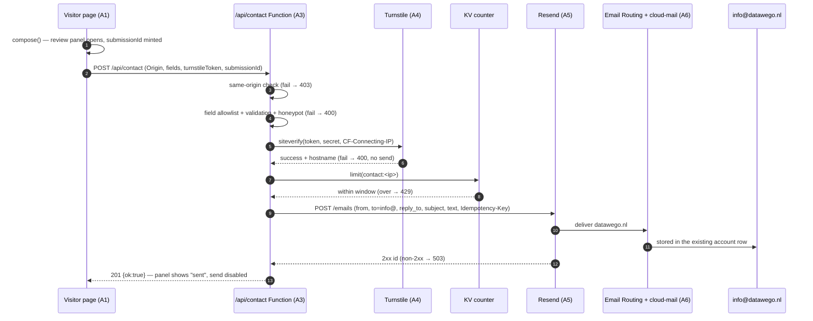
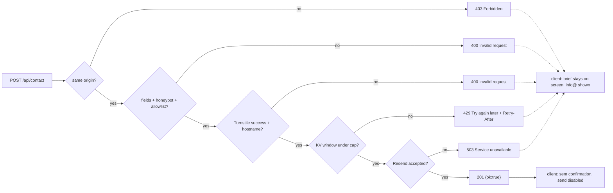

# Contact Form Email Delivery - Plan

## Goal Capsule

- **Objective:** A visitor who fills in the `#contact` brief and presses send finds that enquiry in the `info@datawego.nl` mailbox, and DataWeGo can answer it from there.
- **Means:** A same-origin `POST /api/contact` Pages Function in this repo delivers the message through Resend; cloud-mail stays out of the request path and keeps hosting the receiving mailbox (KTD1).
- **Authority:** R-IDs own product behaviour, KTDs own implementation mechanism, units own sequencing and files. Where they disagree, R wins on behaviour and KTD wins on mechanism.
- **Execution profile:** code, in `datawego_home`, plus Cloudflare configuration for the `datawego` Pages project. `cloud-mail` (the mailbox) is read for evidence and not modified. `edm_home` (the pattern being ported) is read for evidence and touched once, to append one row to its Turnstile hostname registry, which is that repository's own rule for a shared-widget addition.
- **Stop conditions:** five units, dependency-ordered. U1 needs the operator for the Cloudflare and Resend configuration, and U5 needs the same person for the live submits, webmail reads, and dashboard checks; U3's verification needs one real send from a browser. Nothing here waits on an unresolved launch-blocking question.

---

## Product Contract

### Summary

The contact form composes an enquiry and then hands it to `mailto:` with no recipient, so the button opens an empty draft in the visitor's mail client and nothing reaches DataWeGo. This plan gives the page a real send: the composed brief is posted to a same-origin `/api/contact` Pages Function, which checks a Cloudflare Turnstile confirmation and delivers the message through Resend to `info@datawego.nl`. The mailbox already exists and is not touched. When a send fails, the brief stays on screen with the address shown for manual use, so a lost enquiry is visible to the visitor instead of silently evaporating.

### Problem Frame

`www.datawego.nl` is the only public surface DataWeGo has, and `#contact` is the only conversion path on it. Every enquiry that arrived there was lost in a way that produced no evidence of loss: the browser reported `Launched external handler for 'mailto:?subject=…'` and the visitor, if they noticed the empty To field, had to go looking for the address in the footer. Prospective healthcare and life-sciences clients are exactly the audience least willing to do that. The copy admits the situation — the section states that "no backend is connected" — so this is a feature the site has been promising since it shipped, not a regression.

### Requirements

**Delivery**

- R1. Sending a composed brief delivers one message to `info@datawego.nl` that carries the visitor's name, email address, organisation, need, and problem statement.
- R2. Replying to that message in the DataWeGo mailbox reaches the visitor rather than DataWeGo.
- R3. The endpoint accepts a submission only from the page that served it, and both `datawego.nl` and `www.datawego.nl` qualify.
- R4. Recipient, sender, and subject shape are fixed by the server, so no request can aim the send at any other address, and a request carrying a filled `website` trap field is refused as invalid input.

**Abuse resistance**

- R5. A submission without a valid, previously unused Turnstile confirmation is rejected with no send attempted.
- R6. Submissions from one visitor IP address are capped at a small number per minute; KTD4 sets the number.

**Visitor experience**

- R7. The compose → review → send flow is preserved, and the confirmation step lands where the visitor expects to acknowledge being human.
- R8. A successful send is confirmed in the panel, and that panel stops offering to send the same brief a second time.
- R9. A failed send leaves the brief on screen, states the failure in the visitor's language, and shows `info@datawego.nl` for manual use; no mail client opens on its own.
- R10. Retrying a failed brief delivers it once, and editing the answers before sending again delivers a second, separate enquiry.
- R11. New labels, statuses, and error messages exist in English and Dutch, and the section stops describing itself as backend-free.

**Boundary**

- R12. cloud-mail's code and configuration are unchanged by this work; it remains the mailbox that receives `info@datawego.nl`.

**Key decisions**

- **Send from the site, leave the mail app alone.** The site owns the send; cloud-mail only receives. Governs R4, R12. `(session-settled: user-directed — chosen over adding a public send endpoint to cloud-mail: cloud-mail has no public send route, and routing an internal-recipient send through it writes to its database without delivering)`
- **Confirm the visitor with Turnstile.** Governs R5, R7. `(session-settled: user-directed — chosen over an unguarded endpoint or a silent challenge: an open `POST` on a verified domain is an open relay, and an invisible check would hide the reason a submission was refused)`
- **Never fail quietly.** Governs R8, R9. `(session-settled: user-directed — chosen over an automatic `mailto:` fallback on failure: opening a mail client is precisely the behaviour that made the original bug invisible)`
- **Keep the two-step flow.** Governs R7, R10. `(session-settled: user-approved — chosen over a single submit-and-go form: the review panel is the site's one differentiator and it is what makes a retry idempotency key meaningful)`

### Actors

- A1. **Visitor** — a prospective client on `datawego.nl` or `www.datawego.nl`, in English or Dutch, possibly on a phone.
- A2. **DataWeGo inbox reader** — reads `info@datawego.nl` in cloud-mail webmail and replies there.
- A3. **Pages Functions runtime** — the site's own request handler for `/api/contact`.
- A4. **Turnstile** — issues and validates the visitor confirmation; a single managed widget is shared with `edmf.nl`.
- A5. **Resend** — accepts the API send for the verified `datawego.nl` domain using a key whose sending access is restricted to that one domain, not the account key cloud-mail draws on.
- A6. **Cloudflare Email Routing → cloud-mail** — delivers inbound mail for the domain into the existing `info@` account row.

### Acceptance Examples

- AE1. **A working send.** Covers R1, R2, R7. Given a visitor completes name, email, need, and problem and presses send, Then within a minute one message sits in the `info@datawego.nl` inbox whose body carries those four values plus the organisation, and Then replying there arrives at the visitor's address.
- AE2. **A failed send stays honest.** Covers R9. Given Resend is unreachable, Then the review panel still shows the composed brief, the status line reads as a failure in the visitor's language, `info@datawego.nl` is offered as a link, and no mail client opened.
- AE3. **A retry does not double-send.** Covers R10. Given a send failed and the visitor presses send again twice without editing, Then the mailbox holds exactly one copy of that enquiry.
- AE4. **An edit produces a new enquiry.** Covers R10. Given a visitor sends, chooses "Edit answers", changes the problem statement, and sends again, Then the mailbox holds two messages.
- AE5. **A script gets nothing.** Covers R4, R5. Given a request posts a well-formed body to `/api/contact` from another origin, without a Turnstile token, with the `to` field added, or with a spent token, Then the response is a 4xx and no message was handed to the provider.
- AE6. **A patient visitor is not punished.** Covers R5, R7. Given a visitor reviews the brief for longer than five minutes and then presses send, Then the widget refreshes, the retry succeeds, and they see the confirmation.
- AE7. **The page opened from disk.** Covers R9, R11. Given a visitor who followed the README and double-clicked the HTML file presses send, Then the send cannot reach the endpoint from `file://`, and the failure state says so and shows the address instead of a console error.

### Scope Boundaries

**Considered and not built**

- Storing enquiries outside the mailbox (a D1 table, a KV log, a spreadsheet). The mailbox is the product; a second copy needs a reason to exist. Evidence that would change this: a request to search or export past enquiries.
- An automatic reply to the visitor. cloud-mail can do it; R12 keeps it untouched and nobody asked.
- A CRM or Slack notification path alongside the email. The email is the notification.
- A zone WAF rate-limit rule as the throttle. Turnstile is the gate and the KV counter (KTD4) is the cap; a second limiter is a second thing to keep configured. Evidence that would change this: limiter misses showing up in the Functions logs.
- A queue, retry worker, or outbox for sends that fail. R9 puts a failed send in front of a person within seconds, which is cheaper than any retry ladder.
- CORS support, an `OPTIONS` handler, or a public API story for `/api/contact`. Only this site's page calls it (R3).
- Headless browser or DOM-level tests for the inline client script. This repo (`datawego_home`) has no harness, and Turnstile's managed challenge cannot be passed headlessly; U3 and U5 verify in a real browser.

**Deferred to follow-up work**

- Provisioning a dedicated `noreply@datawego.nl` mailbox in cloud-mail's admin if `From` equal to `To` reads badly in the inbox (KTD6).
- Reading the `account` table to pick the best existing local-part for `CONTACT_FROM` once the site is live.
- Adding the Dutch entry for the `Data governance` option, which is silently untranslated today.
- CI for this repo. Nothing here needs it; the test file runs under plain Node.
- Deleting the untracked `docs/datawego.nl.txt` zone export from the working tree — it publishes the full zone to whoever gets a copy of the folder.

### Dependencies

- **Resend domain `datawego.nl` must be verified for sending.** DKIM `resend._domainkey.datawego.nl` and `send.datawego.nl` → `send.forge.rmta.net` are present in live DNS as of 2026-10-09, and `cloud-mail/docs/plans/2026-10-08-2300-feat-edmf-to-datawego-cutover-plan.md` records the domain being verified on that account. U1 re-confirms it with a real delivery before any code depends on it, and mints the site its own key rather than sharing cloud-mail's.
- **A `RESEND_API_KEY` value that only the operator can supply.** It cannot be read out of cloud-mail: the KV entry is runtime-authoritative and masked in that admin UI.
- **The existing managed Turnstile widget**, sitekey `0x4AAAAAAE_LDKoiHQlhtMM2`, mode managed. `edm_home/docs/deploy/turnstile-authorized-hostnames.md` is the authoritative record of its hostname list: `edmf.nl`, `european-digital-medicines.pages.dev`, `datawego.nl` (which covers `www.` on label boundaries), `localhost`, and `127.0.0.1`. `datawego.pages.dev` is absent, which is the one gap U1 closes, and the same document states that the widget is shared with another company's live forms and that additions are additive-only.
- **The `datawego` Pages project**, which today has no Functions, no secrets, and no bindings: `POST https://www.datawego.nl/api/contact` answers 405.
- **The live deployment already matches `HEAD`** (`3095d4c`, deployed 2026-10-09), so this work's deploy ships the contact change and nothing else. The served page differs from the tracked HTML in one place — Cloudflare's email-protection rewrite of the footer `mailto:` link — and the Function must not depend on that rewrite.

---

## Planning Contract

### Key Technical Decisions

- KTD1. **The send lives in a Pages Function in this repo.** `functions/api/contact.js` calls `POST https://api.resend.com/emails` with `RESEND_API_KEY`; the recipient is a module constant. cloud-mail is not in the request path — its `/email/send` route needs a JWT carrying the `email:send` permission, and a send whose recipients are all on `datawego.nl` is classified internal and written to its database without ever being delivered. `(session-settled: user-directed — chosen over adding a public send endpoint to cloud-mail: that would put an unauthenticated mail relay inside the mail app for everyone's domain)` Instantiates the "Send from the site" key decision; governs R4, R12.
- KTD2. **Every uncertain gate denies.** Unset `TURNSTILE_SECRET`, missing or malformed field, spent token, or non-JSON body → 400 with no provider call; unset `RESEND_API_KEY` or a provider failure → 503. This is the behaviour of `verifyTurnstile` in edm_home's helper and it is kept deliberately: a half-configured deployment must fail loudly rather than turn into an open relay. The limiter is the one deliberate exception: a missing KV binding skips the counter rather than blocking traffic, because the Turnstile gate ahead of it already refuses scripted floods (KTD4). Governs R5, R6.
- KTD3. **One Turnstile confirmation per composed brief, verified server-side.** The widget renders inside the review panel, above the button row, so the confirmation is on screen at the moment the visitor presses send; the client reads the token out of the injected `cf-turnstile-response` field, posts it as `turnstileToken`, and resets the widget after any failed send. `.form-grid` is the wrong host for it: `compose()` sets that container to `display: none` for the whole review state, which would make a visible managed widget behave like the silent challenge this decision rejects.
- KTD3a. **The server-side hostname rule is exact equality with the host that served the page**, compared after stripping any port, never a substring or suffix test. Production admits `datawego.nl`, `www.datawego.nl`, or the `<hash>.datawego.pages.dev` URL that served the request; `wrangler pages dev` admits `localhost` or `127.0.0.1`. The same sitekey also serves `edmf.nl`, and the widget's hostname list already includes `localhost`, so a loose rule would let a token minted anywhere else, or `datawego.nl.attacker.tld`, satisfy the gate. Because the same-origin check already requires the request's `Host` to equal its `Origin`, admitting a hostname equal to the serving host admits no new caller. Instantiates the Turnstile key decision; governs R3, R5, R7.
- KTD4. **Rate limiting is a KV counter, placed after the Turnstile gate.** Pages Functions have no `Rate Limiting` binding, so edm_home's `RATE_LIMITER` helper cannot be ported — it returns "allowed" whenever the binding is missing. The port counts `contact:<CF-Connecting-IP>` in a KV namespace over a 60-second window and admits **five** accepted submissions per IP address inside it; the sixth returns 429. A missing binding skips the counter rather than blocking traffic (KTD2's exception), and a KV read-then-write is only eventually consistent, so the counter is a backstop against a visitor retrying in a loop and against one office's shared address, not the load-bearing gate — Turnstile is. Governs R6.
- KTD5. **The idempotency key is one UUID per composed brief**, minted the first time that brief is composed, reused by every retry of it, and replaced only by the "Edit answers" action. `compose()` runs again on every language switch while the panel is open, so the mint cannot live there. Resend dedupes a key for 24 hours, so an id minted once per page view (the edm_home pattern) would swallow a legitimate second enquiry from someone who edited their answer. Governs R10.
- KTD6. **`from` is `DataWeGo Website <info@datawego.nl>`, overridable by the `CONTACT_FROM` secret, with `reply_to` set to the visitor.** cloud-mail rejects mail for local-parts with no account row, so a `noreply@` that exists only in DNS would bounce every delivery failure into nothing. `From` equal to `To` is the cost; if it reads badly in the inbox, the fix is a real `noreply@` mailbox, which is deferred rather than built here. Governs R1, R2.
- KTD7. **Payload values stay English; labels translate.** The `need` select's `value` attributes are English and its visible text is translated at runtime, so the submission carries the `value` and the subject is `Data enquiry — <need>` in English. The review panel keeps showing the Dutch label. This mirrors edm_home's rule and keeps one searchable vocabulary in the mailbox. Governs R1, R11.
- KTD8. **Tests stay dependency-free.** The Function is a plain ESM module; Node 22's `node --test` imports it from a `.mjs` test with a stubbed global `fetch` and a fake `env`, which was confirmed to work without adding `package.json` or a build step to this repo. `datawego_home` has neither, and edm_home's vitest setup drags a full front-end build.

### High-Level Technical Design

One enquiry, end to end:



The gate order is the contract; each gate family has its own status — origin 403, field, honeypot and confirmation problems 400, limiter 429, provider 503 — so the client can say the right thing:



The upload shape the deploy must produce:

```
datawego_home/
├── functions/
│   ├── api/
│   │   ├── _contact.js          # shared helpers: json, origin, siteverify, KV limit, send
│   │   └── contact.js           # onRequestPost — the gate ladder above
│   └── __tests__/
│       └── contact.test.mjs     # node --test guard tests
└── dist/                          # gitignored; deploy.js assembles it
    ├── _routes.json             # {"version":1,"include":["/api/*"],"exclude":[]}
    └── (no functions/, no _worker.js — asserted by deploy.js)
```

### Assumptions

- Both hostnames CNAME to the same Pages project and share one production deployment, so one Function deploy serves both.
- The `info@datawego.nl` account row and Email Routing for the domain keep working as they do now; this plan adds volume to that mailbox, not configuration.
- Sending to a single verified-domain recipient per request stays far inside the Resend free tier's daily quota.
- Local development uses the Turnstile always-pass test keypair, so U2's and U3's local runs are reachable without solving a real challenge; U5's refusal matrix runs against the live widget on `www.datawego.nl`. Cloudflare documents that keypair as working on any domain and reporting the page's own host in `hostname`, which is what makes KTD3a's local branch hold; a production secret rejects its dummy token outright.
- An `info@datawego.nl` row exists in cloud-mail's `account` table, so Email Routing accepts the address. U1 step 2's test send is the confirmation; nothing in this plan reads that table.
- Resend replays a cached result for a reused idempotency key inside its 24-hour window, which is the whole of AE3's guarantee. The provider's docs establish the replay for a delivered send; what a replay returns for an attempt that failed has not been observed here.

---

## Implementation Units

### U1. Prove the mail path and configure the project

- **Goal:** Before any code exists, the `datawego` Pages project can run a Function with the credentials and bindings it needs, and a Resend send for `datawego.nl` lands in the `info@` mailbox.
- **Requirements:** R1, R2, R4, R5, R6, R12
- **Dependencies:** none
- **Files:** no repository files — Cloudflare Pages project configuration, one KV namespace, the Turnstile widget hostname list, and the Resend dashboard.
- **Approach:**
  1. Confirm Resend lists `datawego.nl` as verified for sending, then mint a **new** API key whose sending access is restricted to that domain and use it for the site. Do not reuse the account key: it can send for every verified domain on the account, so a copy of it reaching this repo or a log line would be a domain-wide phishing capability rather than a broken form. Resend's KV entry for the domain in cloud-mail is runtime-authoritative and masked, so nothing here can read a key out of the mail app.
  2. Send one test message through the Resend API from the operator's machine — `from` `DataWeGo Website <info@datawego.nl>`, `to` `info@datawego.nl`, `reply_to` a personal address — and confirm it appears in cloud-mail webmail and that replying reaches the personal address. This proves DKIM alignment, Email Routing, and the account row in one shot.
  3. Create the KV namespace for the limiter (`CONTACT_RATE_LIMIT`) and bind it to the Pages project in both Production and Preview. The project's automation token has no KV write scope, so this pair of steps is dashboard work — it is the only reason U1 is the one unit nobody can run unattended.
  4. Set the project secrets `RESEND_API_KEY`, `TURNSTILE_SECRET`, and `CONTACT_FROM` before the first Function deploy; secrets do not apply to a deployment that predates them.
  5. Add `datawego.pages.dev` to the shared widget's hostnames through the guard that already owns that list. In `edm_home`, `node front-end/scripts/check-turnstile-hostnames.mjs --host datawego.pages.dev` reads the live config and prints the complete merged list to set — its merge never drops an entry — and `docs/deploy/turnstile-authorized-hostnames.md` is where the addition gets recorded, because that document's rule is additive-only: this same widget guards `edmf.nl`'s Contact and Membership forms, and a `PATCH` carrying a partial list silently unauthorizes the hosts left out.
  6. Set the Functions runtime to fail closed, and confirm the zone has no Cache Everything page rule or `/api/*` cache rule.
- **Execution note:** Step 2 is a gate, not a formality. If the test message does not appear in the mailbox, stop and resolve the DNS or Email Routing cause before writing U2 — the rest of the plan assumes delivery works.
- **Test scenarios:** `Test expectation: none --` project configuration with no code to exercise; every observable here is a probe recorded in Verification Contract and re-proved in U5.
- **Verification:** The Resend dashboard shows `datawego.nl` verified with a passing DKIM check; the test message is readable in `info@` webmail with a passing signature; `wrangler pages secret list` for the project names all three secrets; the KV binding appears in both environments; `check-turnstile-hostnames.mjs` exits 0 for both `datawego.nl` and `datawego.pages.dev`, the registry table names the new entry with the date it was added, and `edmf.nl`'s contact form still returns 201 for one real submit.

### U2. `POST /api/contact` — the send endpoint

- **Goal:** A Function that turns a validated, human-confirmed submission into exactly one delivered enquiry, refusing each gate family with that family's status.
- **Requirements:** R1, R2, R3, R4, R5, R6, R9, R10, R12
- **Dependencies:** U1
- **Files:** `.gitignore`, `functions/api/contact.js`, `functions/api/_contact.js`, `functions/__tests__/contact.test.mjs`
- **Approach:**
  1. Add `.dev.vars` to `.gitignore` before anything else — it is not ignored in this repo today, and step 7's local run puts live credential values in that file. `edm_home` tracks its own `.dev.vars`; that is the outcome to avoid.
  2. Port edm_home's gate ladder and status codes in the same order (KTD2, HTD flowchart), with the limiter moved behind the Turnstile check (KTD4).
  3. Put the reusable pieces — `jsonNoStore`, `sameOrigin`, `clientIp`, `normalizeEmail`, `parsePublicJson`, `verifyTurnstile`, `limitByIp`, `sendResend` — in `_contact.js`, and keep the recipient `info@datawego.nl` and the subject shape as module constants (R4).
  4. Validate: name 2–160, email against the address shape and ≤320, optional organisation ≤160, `need` within the six option values in the select, message 12–4000, `submissionId` ≤128. Reject any key outside the allowlist, and reject a truthy `website` honeypot field with the same generic 400 as any other invalid field, so the response gives a script no signal about why it was refused.
  5. Hand Resend `from` = `CONTACT_FROM` (KTD6), `to` = the constant, `reply_to` = the visitor, `subject` = `Data enquiry — <need>`, plain-text body, and `Idempotency-Key` = `submissionId` (KTD5).
  6. Answer `{ok:true}` with 201 on success; on provider failure log the provider's status and body server-side and return a bare 503 so the visitor's message stays generic (R9).
  7. Every response carries `Cache-Control: no-store` (R3, and the reason no `_headers` file is needed).
- **Patterns to follow:** `edm_home/functions/api/contact.ts` for order and codes and `edm_home/functions/api/_publicForms.ts` for the helpers; `edm_home/functions/api/join.ts` is the anti-model — it collapses origin and rate failures into one 400 and returns 200 for a deduplicated send.
- **Technical design:** directional only — the request body grammar is `{name, email, org?, need, message, turnstileToken, submissionId, website}` and the response grammar is `{ok, error?, accepted?}`.
- **Test scenarios:**
  - Happy: a complete submission from the page's own origin with a passing verify response returns 201 and the single provider call carries `to: ["info@datawego.nl"]`, `reply_to` equal to the visitor's email, and an `Idempotency-Key` header equal to the submitted `submissionId`. Covers R1, R2.
  - Body shape: the `need` posted is the English option value and the subject is `Data enquiry — Data platform`. Covers R1, KTD7.
  - Origin: a request with `Origin: https://evil.example` returns 403 and never reaches the provider. Covers R3.
  - Unknown key or added `to`: a body containing `to` or any unlisted field returns 400 and never reaches the provider. Covers R4.
  - Honeypot: a filled `website` field returns 400 with no provider call and the same generic error as any other invalid field. Covers R4.
  - Turnstile: a missing token, a verify response of `success:false`, an unset `TURNSTILE_SECRET`, and a `success:true` response whose `hostname` differs from the serving host each return 400 with no provider call. The differing-hostname cases are `edmf.nl`, `localhost`, `datawego.nl.attacker.tld`, and `<hash>.datawego.pages.dev` while the request's `Host` is `www.datawego.nl` — the last three catch a contains- or suffix-style implementation of KTD3a. Covers R3, R5, KTD2, KTD3a.
  - Limits: six submissions from the same IP inside the window return 201 five times and then 429 with `Retry-After`; five from each of two different IPs are both served in full; with the KV binding absent, every request is served. Covers R6, KTD4, KTD2.
  - Field edges: 4001-character message, 1-character name, `need` outside the option list, and a non-JSON `Content-Type` each return 400. Covers R4.
  - Provider failure: a 422 from Resend returns 503, and the provider's status is what the log line records. Covers R9.
  - Integration: an idempotent replay — the same `submissionId` twice — produces two 201 responses to the client but one delivered message, because the provider dedupes; assert the key is forwarded verbatim rather than regenerated. Covers R10.
- **Verification:** `node --test` passes from the repo root with no new dependencies; `npx wrangler pages dev dist` serves the Function, with local values read from the git-ignored `.dev.vars` — ignored by this unit's own step 1 — and never from a tracked path. Two runs: a `curl` POST with a test-key token returns 201 while `RESEND_API_KEY` reaches a working provider, and a second run with a deliberately bogus `RESEND_API_KEY` returns 503 — both branches proved locally before anything is deployed.

### U3. Make the page send, and tell the truth about what happened

- **Goal:** The review panel's primary action is a real send, and success, failure, and retry each read differently to the visitor in their own language.
- **Requirements:** R1, R3, R5, R7, R8, R9, R10, R11
- **Dependencies:** U2 (for the request and response contract)
- **Files:** `datawego-company-site.html`
- **Approach:**
  1. Replace the "Open in mail client" button with "Send enquiry" (`#brief-send`, `data-od-id="contact-send"`) and keep "Edit answers"; put the markup for the widget, the honeypot input, and both feedback states directly in the HTML and toggle `hidden`, because the i18n collector indexes the DOM once at load and injected nodes never translate.
  2. Mount the managed widget in the review panel — a full-width row inside `#brief-out`, directly above the `.row-between` that holds the buttons — with the inlined sitekey (KTD3). The panel's existing `hidden` toggle already shows and hides that subtree, so "Edit answers" keeps the widget's state correct without new code. Not the end of `.form-grid`: `compose()` hides that container for the whole review state.
  3. On send: if the injected `cf-turnstile-response` field is empty, stop and write the confirmation-pending or confirmation-unavailable sentence instead of posting — posting an empty token only produces a 400 the visitor cannot interpret. Otherwise set a pending state (new disabled and spinner styles for `.btn`, which has none), read the token out of that field, strip it from the serialized body, and post JSON with `turnstileToken`, `submissionId`, `website: ""`, and `need` taken from `form.elements.need.value` rather than the translated label (KTD3, KTD7).
  4. Mint `submissionId` the first time a brief is composed and keep it for every later press on that brief. Replace it in the "Edit answers" handler and nowhere else — `renderLang` calls `compose()` again whenever the panel is open, so a mint inside `compose()` would hand a fresh idempotency key to a visitor who only switched language, and their retry would deliver a second enquiry (KTD5).
  5. On 201: show the sent state, disable send for that brief, move focus to the status element the disabled button belonged to, and clear the stale "nothing was sent" line (R8, R11). Disabling the element that holds focus otherwise drops it to the top of the page for the next Tab.
  6. On any failure: keep `#brief-out` and the summary visible, write the failure into the status line through `statusEN` so `renderLang` re-applies it on language switch, show `info@datawego.nl` as a `mailto:` link with the recipient filled in, move focus to the status line, and reset the widget (R9, KTD3). Give the notice a danger-tinted variant and switch `#brief-status` to `role="alert"` in this state — `.notice` is tinted from `--success` today, so a refused send would otherwise render in the same green treatment as a delivered one, which is the quiet failure this plan exists to remove. Keep `role="status"` for the sent confirmation.
  7. Map each gate family to its own sentence: 400 confirmation or answer problems, 403 wrong address, 429 try again shortly, 503 service did not answer, plus a sentence for a send that never reached the server at all (a rejected `fetch`, which is what `file://` produces). Each new English string needs a matching entry in the NL dictionary's contact block.
  8. Rewrite the caveat line that says no backend is connected, plus its Dutch entry (R11).
- **Patterns to follow:** the closing IIFE's contact block for field ids and validation, `var statusEN` for status text, and `edm_home/front-end/src/prototype/PrototypeForms.tsx` for the send/retry state machine — behaviour only, not the hook or the build-time sitekey.
- **Technical design:** the panel's states are `idle → pending → sent` or `idle → pending → failed → pending`, one brief per cycle; the widget is reset on entry to `failed`. The widget carries its own two states beneath that — loading until a token exists, unavailable when its script or challenge fails — and both are surfaced in the status line rather than left as an inert box.
- **Test scenarios:** verified in a browser, since this file has no DOM harness.
  - Happy: complete the form in English, review, send → confirmation sentence, send button disabled, and exactly one `POST /api/contact` in the network log. Covers AE1, R8.
  - Idempotent retry: block the network, send (fails), unblock, send again → the same `submissionId` in both requests. Covers AE3, R10.
  - A language switch is not an edit: send (fails), switch to Nederlands, press send twice → `submissionId` unchanged in every request and one message in the mailbox. Covers AE3, R10, R11.
  - Edited resend: send, "Edit answers", change the message, send again → a new `submissionId` and a second delivered enquiry. Covers AE4, R10.
  - Stale token: leave the review panel open for more than five minutes, press send → the widget, visible in the panel, refreshes and the second attempt succeeds. Covers AE6, R5, R7.
  - Widget unavailable: block `challenges.cloudflare.com`, and separately open the page on a hostname the widget has never been told about, which fails client-side with Turnstile error `110200` → in both cases no request leaves the page, the status line reads as a confirmation problem, and the address is offered below it. Covers R5, R9.
  - Dutch: switch to Nederlands, complete and send → every new status, label, and error reads Dutch, including the rewritten caveat. Covers R11.
  - Failure honesty: stop the Function (bad secret) and send → brief still on screen, failure sentence shown in the danger treatment rather than the success tint, address link present, and no mail client opened. Covers AE2, R9.
  - Narrow screen: at 360px the widget row, the status line, and both feedback states fit the panel with no horizontal scroll. Covers R7.
  - Hidden fields: the honeypot input stays hidden through compose, edit, and failure, and never steals focus. Covers R4.
  - `file://`: open the file from disk and send → the `fetch` never reaches the endpoint, the client-side failure state names that and shows the address, and no mail client opens. Covers AE7.
- **Verification:** A local `wrangler pages dev` submit produces a visible widget, a 201, and a real enquiry in the mailbox (KTD3a admits `localhost` because it is the serving host); a broken `RESEND_API_KEY` produces the failure state with the brief intact; switching language in either state re-renders the sentence and leaves the idempotency key alone.

### U4. Wire the deploy so Functions exist and pages stay static

- **Goal:** `node deploy.js` ships the Function and routes only `/api/*` through it.
- **Requirements:** R3, R12
- **Dependencies:** U2
- **Files:** `deploy.js`, `README.md`, `.gitignore`, `.dev.vars.example`
- **Approach:**
  1. Keep `functions/` tracked at the repo root and copy nothing into `dist/`. The Direct Upload docs read the Functions directory from where the command is run rather than from the uploaded directory, and `deploy.js` already runs wrangler with `cwd` set to the repo root, so a root `functions/` is bundled without help. `edm_home/deploy.js` additionally copies `functions/` into the directory it uploads; those are dead static assets sitting next to the working Function, and that part of the pattern is not worth porting.
  2. Commit a secret-free `.dev.vars.example` listing `RESEND_API_KEY`, `TURNSTILE_SECRET`, and `CONTACT_FROM`, so the next person learns the local shape without reading the Function.
  3. Before deploying, have `deploy.js` write `dist/_routes.json` with `include: ["/api/*"]`, and assert that `dist/` contains no `_worker.js` and no `functions/` directory — either one silently disables the Function or uploads its source as an asset.
  4. Add the project's new shape to README: the Functions directory, the secrets and binding the project needs and where they live locally (`.dev.vars`, ignored), the fact that double-clicking the HTML now refuses to send and what to do instead, and the local `wrangler pages dev` route.
  5. Confirm the deploy reports Functions as part of the deployment and that the project's `uses_functions` flips.
- **Execution note:** If the first deploy shows the endpoint answering 405, the root `functions/` was not picked up for this project; only then fall back to assembling functions into the upload directory, and keep the "no `dist/functions` as static assets" assertion by checking whether routing or a leak is what appears.
- **Test scenarios:** `Test expectation: none --` packaging and documentation; the behaviour it enables is proved by U2's curl checks and U5's live probes.
- **Verification:** The deploy log names the Function; a request to an unrelated path still serves HTML without invoking it; `https://datawego.nl/functions/api/contact.js` does not return Function source; a POST to `/api/contact` is no longer 405.

### U5. Prove the whole path on the live site, including the refusals

- **Goal:** Evidence that a real visitor's enquiry reaches a real inbox from the deployed site, and that the endpoint refuses everything else.
- **Requirements:** R1, R2, R3, R4, R5, R6, R8, R9, R10, R11
- **Dependencies:** U1, U2, U3, U4
- **Files:** `functions/__tests__/contact.test.mjs` (extend only if a probe reveals a gap)
- **Approach:**
  1. Submit a real enquiry from `https://www.datawego.nl` with a visitor address the operator controls, then from `https://datawego.nl` — both must land, proving R3 across two origins.
  2. Read the messages in cloud-mail webmail as `info@` and reply to one; confirm arrival at the visitor address.
  3. Run the refusal matrix against production with `curl`: no `Origin`, foreign `Origin`, filled honeypot, unknown extra field, a spent token replayed, and a body over the length cap. None may produce a message in the mailbox.
  4. Check the Resend dashboard for each send: DKIM and SPF pass, and the spam-complaint counter stays at zero.
  5. Confirm no additional billable pattern appeared: page views do not invoke the Function.
- **Test scenarios:**
  - Live submit from `www` returns 201 and one message appears in `info@` within a minute. Covers AE1, R1.
  - Reply from the mailbox reaches the visitor. Covers R2, KTD6.
  - Token replay returns 400 and no second message. Covers R5, AE5.
  - `curl -X POST` with no `Origin` (as from `file://`) returns 403. Covers AE7, R3.
  - Ten rapid submissions from one IP address, each pressed from a fresh page load so every request carries a new token: five return 201, the rest return 429 with `Retry-After`, and the mailbox holds five messages. Covers R6.
  - A visitor-reported failure is traceable in the Functions logs to a status line naming the provider response. Covers R9.
- **Verification:** Every scenario above has an observed outcome, the two hostnames both delivered, and the mailbox shows enquiries that were impossible before this work.

---

## Verification Contract

| Gate | Command or check | Applies to | Proves |
| --- | --- | --- | --- |
| Guard tests | `node --test` | U2, U5 | Gate order, status codes, provider payload, no provider call on refusal |
| Local endpoint run | `npx wrangler pages dev dist`, then POST with the Turnstile always-pass test keypair (values in the ignored `.dev.vars`) | U2, U3 | The Function really runs and 201/400/503 branches are reachable off-network |
| Deploy shape | deploy log + `GET` the project's `uses_functions` | U4 | Functions are registered and routed by `_routes.json` |
| Live positive | one real submit from each hostname, read in `info@` webmail | U5 | End-to-end delivery through Resend, Email Routing, and cloud-mail |
| Live negative | the `curl` refusal matrix | U5 | No relay, no unconfirmed send, no flood |
| Provider hygiene | Resend dashboard: domain verified, DKIM/SPF pass, complaints zero | U1, U5 | The shared key's reputation is not being spent |
| Cost shape | request a page and confirm no Function invocation | U4 | Static traffic stays static |
| Secret hygiene | `git check-ignore .dev.vars` and `git log --all -- .dev.vars` after U4 | U4 | No credential value enters this repo's history |
| Accessibility/finish | EN and NL passes over the new panel states, plus a keyboard and screen-reader pass that follows focus through `idle → pending → sent` and `idle → pending → failed` | U3 | R11 with no silent-English leftovers, and the state change is announced rather than lost |

No release-validation tooling exists in this repo, and no skill-behaviour evaluation applies.

---

## Definition of Done

**Global**

- An enquiry submitted from the deployed site is readable in `info@datawego.nl` within a minute and replyable to the visitor (R1, R2).
- Every refusal path returns its gate family's status and produces no send, and each is demonstrated against the live endpoint (R3-R6).
- Success, failure, retry, and edit-then-resend each behave as AE1-AE7 describes, in both languages (R7-R11).
- No file outside `datawego_home` changed except the one added row in `edm_home`'s Turnstile hostname registry; cloud-mail's code, configuration, and settings are as they were (R12).
- The abandoned-attempt residue is gone: no scratch probe scripts, no commented-out `mailto:` block, no stray `.bak`, no `functions/` copy inside `dist/`.

**Per unit**

- U1: the pre-code test message reached the mailbox and the project reports three secrets plus one KV binding.
- U2: `node --test` green, and each refusal demonstrably makes zero provider calls.
- U3: the panel's states are distinguishable in a browser in both languages, the widget is visible when send is offered, and focus and the announcement role follow every state change.
- U4: one deploy command ships HTML and Function, `/api/*` is the only routed path, README tells the truth about running locally, and no credential value appears in this repo's history.
- U5: both hostnames delivered, the refusal matrix held, and the Resend dashboard is clean.

---

## Risks & Dependencies

- **Shared Resend key.** The same account API key drives cloud-mail's sending, so a runaway loop here costs quota and sender reputation there. The cap sits on three things: a hardcoded recipient, the KV limiter, and the Turnstile gate ahead of both.
- **`DMARC p=reject` with an apex SPF that does not mention Resend.** Legitimacy rests on the DKIM signature aligned to `datawego.nl` via `resend._domainkey`. If a message ever arrives in spam, the SPF line is a red herring — check the `send.` CNAME and the DKIM result in the Resend log first.
- **Stale DNS evidence in the repos.** `docs/datawego.nl.txt` predates the cutover and shows no Resend records; live DNS shows them. Treat U1's test send, not that export, as the proof.
- **Functions turn every unmatched request into a billable invocation** if `_routes.json` is missing or mis-placed, and a fail-open runtime can serve `functions/` source as an asset. U4 asserts both guards.
- **`From` equal to `To`.** Enquiries will be listed as coming from `info@datawego.nl`; `reply_to` is what saves the reader. If that reads badly, KTD6's deferred mailbox is the fix, not a change of recipient.
- **A send that fails is visible to the visitor and invisible to the owner.** No alerting is in scope; the detection path is a visitor saying "it wouldn't send" plus the Functions log line from U2 step 5.
- **The live site already serves `HEAD`**, so a deploy of this work is a contact change only. Any other visible difference during U5's probes is Cloudflare's email-protection rewrite of the footer link, not an undeployed commit.
- **R2 is decided inside cloud-mail, which R12 keeps untouched.** Its send path refuses a non-admin account whose role is internal-only, and a role's send count caps sends per user per day. U1 step 2 is the only probe. If a reply from `info@` does not reach an external address, R2 and R12 cannot both hold, and resolving that is an operator decision in cloud-mail's admin rather than something U2 can implement around.
- **U1 step 5 edits a widget another site depends on.** `edmf.nl`'s Contact and Membership forms use the same managed widget, and the `PATCH` endpoint replaces the whole list, so a partial payload closes those forms. The guard script and the additive-only registry in `edm_home` are what keep that from happening, which is why U1 uses them instead of composing the request by hand.
- **The limiter keys on the IP**, so visitors behind one office network or carrier NAT share five sends a minute between them. KTD4's number is set to absorb that, and Turnstile's own risk scoring rather than the counter is what stops a flood.
- **A retried brief inherits whatever Resend replays.** AE3 holds only if the provider replays its cached success for a reused key; if it replays a failed first attempt instead, that brief can never send and "Edit answers" — which mints a new key — is the only escape. U3's retry scenario is where this shows up.

---

## System-Wide Impact

- The site's project changes shape: requests matching `/api/*` now execute code, everything else stays a static asset. That is the one cross-cutting consequence, and `_routes.json` is what bounds it.
- A new outbound dependency (`api.resend.com`, `challenges.cloudflare.com`) sits inside a user-facing action, but not inside page load; a slow provider delays a submission, never a render.
- `info@datawego.nl` becomes a conversion channel with real volume. Nothing else in cloud-mail notices; the same inbox and quota absorb it.
- The Turnstile widget, already hostnamed for `datawego.nl` and shared with `edmf.nl`, gains a Preview hostname in `datawego.pages.dev`. One widget minting tokens for several sites is why KTD3a's exact-hostname comparison is not optional, and the change lands in `edm_home`'s hostname registry as well as in Cloudflare, so the next person's check sees the same list this plan set.
- Both hostnames become load-bearing origins; a future change to canonical redirects has to keep the same-origin check honest.

---

## Open Questions

None blocking. Deferred, with owner and trigger named:

- Which existing local-part should `CONTACT_FROM` carry once the `account` table has been read (KTD6). Decide at U1 step 2; the default ships if nobody looks.
- Whether the section carries a one-line note about what happens to a submitted enquiry. Until now the page collected nothing; from U3 it collects a name, an email address, an organisation, and free text, and routes them through Resend and Cloudflare to a mailbox. R11 asks only that the "no backend is connected" caveat stop being false. Adding a sentence about where the enquiry goes is product copy on a healthcare-facing page, so it is the operator's call, not U3's; the trigger is the first deploy, and the default is that the caveat line is rewritten and nothing more is said.
- The English and Dutch wording of the seven new sentences (sent, confirmation pending, confirmation unavailable, wrong address, try again shortly, service did not answer, no response at all). U3 step 7 drafts them against the site's existing voice; R11 requires the Dutch entries to ship in the same change, and the operator approves both before U5.
- Whether `data governance` needs its Dutch option label before the form is advertised (out of scope here, listed in Deferred).

---

## Outcome — shipped 2026-10-10

Merged to `main` (`50f9516`, pushed) and deployed to production
(`83e41a84`, Environment: Production, branch `main`). Cloudflare holds
`TURNSTILE_SECRET` and `RESEND_API_KEY` as production secrets and
`CONTACT_RATE_LIMIT` bound to namespace `028ba25583fd4a6886c3aedd22a435ac`;
`CONTACT_FROM` is unset, so the code's default `DataWeGo Website <info@datawego.nl>`
sends. Resend has `datawego.nl` verified with DKIM and both routing records, and it
accepts the exact payload the Function composes.

U5 found one defect that every prior phase missed, and it was in the page rather than
the Function: `turnstile.render()` was handed `"refresh-expired": "always"`, a value
api.js does not accept, so it threw out of `render()`, the page's catch read that as a
failed check, and every visitor on every host was steered to the mailto fallback with
no request leaving the browser. Offline it was invisible because the test double
answers any options object with a token. Fixed in `50f9516`, and the option vocabulary
api.js validates is now asserted statically — comments are stripped before the option
list is split (a prose note full of commas hid the option from the first version of
that check), and the read is anchored on `sitekey`/`callback`/`error-callback` so a
parse that stops seeing the call fails loudly. 12 mutations of the render call, all
caught; the suite is 20 tests.

Correcting one line in Risks above: `datawego.pages.dev` is **not** on the widget's
hostname list. Measured on the deployed preview alias, the widget raises error code
`110200` and the page shows its fallback row, while `www.datawego.nl` and
`datawego.nl` both render the challenge. Previews on the deployment URL therefore
cannot send; production cannot care. Recorded in `edm_home`'s hostname registry.

The loop closed on the first real send: an enquiry composed in the browser on
`www.datawego.nl` reached `info@datawego.nl` at 19:51:47Z, Resend's `last_event`
`delivered`, subject `Data enquiry — Data platform`, Reply-To the visitor's own
address, and the body in the Function's compose format — the four labelled lines over
the textarea verbatim. So a token was minted by a real browser, `siteverify` confirmed
the exact serving host, and the send went out under the production key. AE1 holds.

Correcting what I wrote above about reading this back: a `contact:<ip>` key is visible
in the namespace for only 120 seconds, the limiter's TTL, so "a key appears in KV" is
not a durable confirmation and the namespace reads empty minutes later. It does not
change the verdict — the delivery does.

Still open, neither blocking:
- The limiter's runtime write has never been *observed*. It is fail-open by design, so
  it cannot cost a visitor a send; six rapid submits from one address is the way to see
  the `429`, which also proves the KV binding is live rather than merely attached.
- R2's reply leg (does a reply from `info@` reach an external address) still rides on
  cloud-mail's routing, untouched here. Reply-To on the enquiry above is the route to
  test it with.
